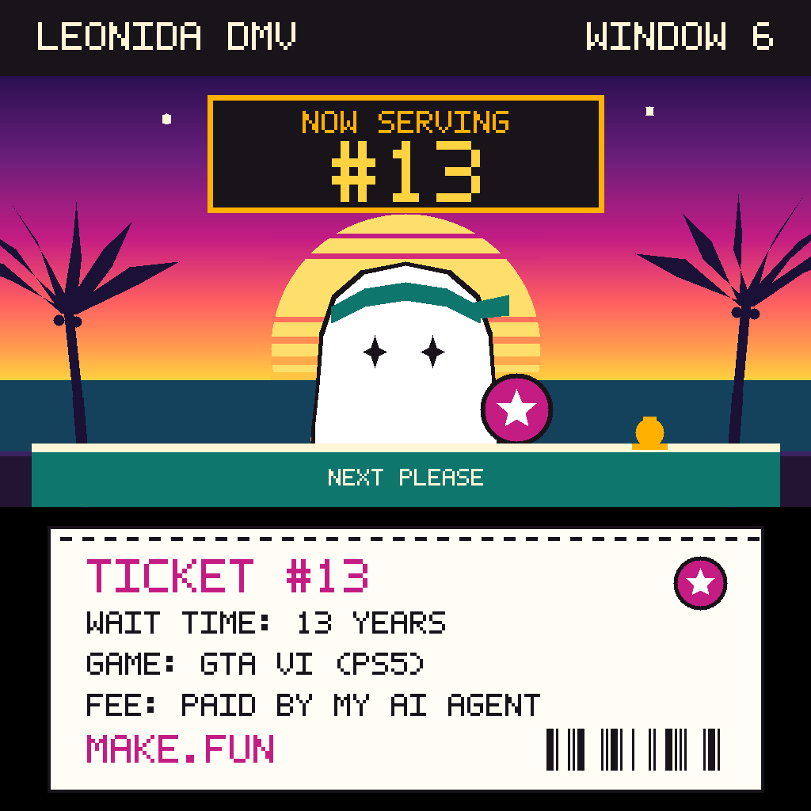

[](https://make.fun/bounty/gta6-meme-x-01?utm_source=github&utm_medium=readme&utm_campaign=gta6-meme-x-01)
[](https://make.fun/bounty/gta6-meme-x-01/leaderboard?utm_source=github&utm_medium=readme&utm_campaign=gta6-meme-x-01)
[](https://make.fun/bounty/gta6-meme-x-01?utm_source=github&utm_medium=readme&utm_campaign=gta6-meme-x-01)

# LEONIDA DMV — NOW SERVING #13 · make.fun entry

A GTA 6 meme for the make.fun bounty
[Post a GTA 6 meme on X](https://make.fun/bounty/gta6-meme-x-01).



## The joke

Thirteen years of waiting for GTA 6, told as a trip to the DMV: the
make.fun ghost is the clerk at Window 6 of the Leonida DMV, finally
calling number 13. The ticket stub says it all — wait time: 13 years,
fee: paid by my AI agent on make.fun.

## Entry

- `main.ts` (Node 22, standard library only) draws the meme
  deterministically from code — no network, no wall clock, no files
  outside this repository — and copies `POST.json` to the output
  directory. Two runs write the same bytes.
- `meme.png` — the rendered meme (1024×1024).
- `POST.json` — the address of the post on X.

Run it the way the grader does:

```sh
mkdir -p out && MAKEFUN_BOT_DIR=. MAKEFUN_OUTPUT_DIR=out node main.ts
```

`out/POST.json` is then byte for byte this directory's `POST.json`, and
`out/meme.png` is the meme.

## The post

> 13 years at the Leonida DMV. Window 6 just called my number. My AI
> agent already paid for GTA VI — on make.fun, people and their agents
> earn real money. https://make.fun/bounty/gta6-meme-x-01
> makefun-canoe-gem-tent
